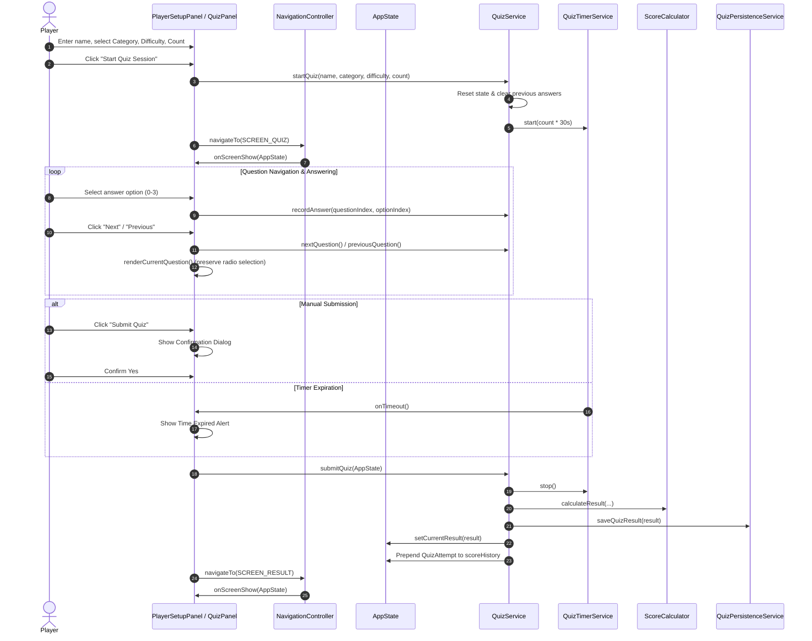
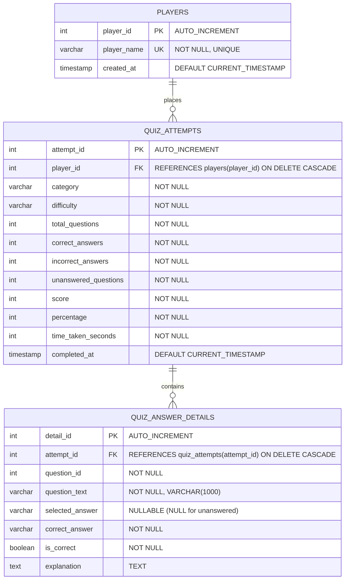

# QuizMaster — Project Architecture Documentation

## 1. Architectural Overview

QuizMaster is engineered following a clean, decoupled **Layered & Model-View-Controller (MVC)** architecture. The system cleanly separates graphical presentation, domain data models, state routing, business calculation engines, and relational persistence.

```mermaid
flowchart TD
    subgraph View ["Presentation Layer (Java Swing)"]
        MF[MainFrame]
        HP[HomePanel]
        PSP[PlayerSetupPanel]
        QP[QuizPanel]
        RP[ResultPanel]
        SHP[ScoreHistoryPanel]
        ARP[AnswerReviewPanel]
    end

    subgraph Controller ["Controller & Navigation"]
        NC[NavigationController\n(CardLayout + Screen Stack)]
    end

    subgraph Domain ["Domain & Application State"]
        AS[AppState]
        QR[QuizResult]
        QA[QuizAttempt]
        Q[Question]
    end

    subgraph Service ["Business Logic Layer"]
        QS[QuizService]
        QBS[QuestionBankService]
        QTS[QuizTimerService]
        SC[ScoreCalculator]
        QPS[QuizPersistenceService]
    end

    subgraph Repository ["Data Access Layer (JDBC Repositories)"]
        PR[PlayerRepository]
        QAR[QuizAttemptRepository]
        QAnsR[QuizAnswerRepository]
    end

    subgraph Database ["Database Layer (MySQL / H2)"]
        DC[DatabaseConnection]
        DConf[DatabaseConfig]
        DI[DatabaseInitializer]
        DB[(quizmaster_db)]
    end

    MF --> NC
    View --> NC
    NC --> AS
    AS --> QS
    AS --> QBS
    AS --> QPS
    QS --> QTS
    QS --> SC
    QS --> QPS
    QPS --> PR
    QPS --> QAR
    QPS --> QAnsR
    PR --> DC
    QAR --> DC
    QAnsR --> DC
    DC --> DConf
    DC --> DB
    DI --> DC
```

---

## 2. Package Structure & Responsibilities

| Package | Key Classes | Primary Responsibility |
|---|---|---|
| `com.quizmaster` | [`Main`](file:///d:/anti%20gravity/Quiz%20Application%20with%20Score%20Tracking/src/main/java/com/quizmaster/Main.java) | Bootstrap entry point; executes on Swing Event Dispatch Thread (EDT) and initializes look-and-feel. |
| `com.quizmaster.model` | [`AppState`](file:///d:/anti%20gravity/Quiz%20Application%20with%20Score%20Tracking/src/main/java/com/quizmaster/model/AppState.java), [`Category`](file:///d:/anti%20gravity/Quiz%20Application%20with%20Score%20Tracking/src/main/java/com/quizmaster/model/Category.java), [`Difficulty`](file:///d:/anti%20gravity/Quiz%20Application%20with%20Score%20Tracking/src/main/java/com/quizmaster/model/Difficulty.java), [`Question`](file:///d:/anti%20gravity/Quiz%20Application%20with%20Score%20Tracking/src/main/java/com/quizmaster/model/Question.java), [`QuizAttempt`](file:///d:/anti%20gravity/Quiz%20Application%20with%20Score%20Tracking/src/main/java/com/quizmaster/model/QuizAttempt.java), [`QuizResult`](file:///d:/anti%20gravity/Quiz%20Application%20with%20Score%20Tracking/src/main/java/com/quizmaster/model/QuizResult.java) | Immutable data records, domain entities, active session state, and historical attempt representations. |
| `com.quizmaster.controller` | [`NavigationController`](file:///d:/anti%20gravity/Quiz%20Application%20with%20Score%20Tracking/src/main/java/com/quizmaster/controller/NavigationController.java) | Manages `CardLayout` transitions, navigation history stack (`navigateBack()`), and screen lifecycle callbacks (`RefreshableScreen`). |
| `com.quizmaster.service` | [`QuizService`](file:///d:/anti%20gravity/Quiz%20Application%20with%20Score%20Tracking/src/main/java/com/quizmaster/service/QuizService.java), [`QuestionBankService`](file:///d:/anti%20gravity/Quiz%20Application%20with%20Score%20Tracking/src/main/java/com/quizmaster/service/QuestionBankService.java), [`QuizTimerService`](file:///d:/anti%20gravity/Quiz%20Application%20with%20Score%20Tracking/src/main/java/com/quizmaster/service/QuizTimerService.java), [`ScoreCalculator`](file:///d:/anti%20gravity/Quiz%20Application%20with%20Score%20Tracking/src/main/java/com/quizmaster/service/ScoreCalculator.java), [`QuizPersistenceService`](file:///d:/anti%20gravity/Quiz%20Application%20with%20Score%20Tracking/src/main/java/com/quizmaster/service/QuizPersistenceService.java) | Core business logic: session lifecycle, 75+ question repository, countdown timer engine, scoring calculation, and transactional persistence coordination. |
| `com.quizmaster.database` | [`DatabaseConfig`](file:///d:/anti%20gravity/Quiz%20Application%20with%20Score%20Tracking/src/main/java/com/quizmaster/database/DatabaseConfig.java), [`DatabaseConnection`](file:///d:/anti%20gravity/Quiz%20Application%20with%20Score%20Tracking/src/main/java/com/quizmaster/database/DatabaseConnection.java), [`DatabaseInitializer`](file:///d:/anti%20gravity/Quiz%20Application%20with%20Score%20Tracking/src/main/java/com/quizmaster/database/DatabaseInitializer.java) | JDBC connection management, environment variable loading (`QUIZ_DB_*`), credential masking, and idempotent DDL execution. |
| `com.quizmaster.repository` | [`PlayerRepository`](file:///d:/anti%20gravity/Quiz%20Application%20with%20Score%20Tracking/src/main/java/com/quizmaster/repository/PlayerRepository.java), [`QuizAttemptRepository`](file:///d:/anti%20gravity/Quiz%20Application%20with%20Score%20Tracking/src/main/java/com/quizmaster/repository/QuizAttemptRepository.java), [`QuizAnswerRepository`](file:///d:/anti%20gravity/Quiz%20Application%20with%20Score%20Tracking/src/main/java/com/quizmaster/repository/QuizAnswerRepository.java) | Data Access Object (DAO) pattern using parameterized `PreparedStatement` instances for SQL CRUD operations. |
| `com.quizmaster.util` | [`UIConstants`](file:///d:/anti%20gravity/Quiz%20Application%20with%20Score%20Tracking/src/main/java/com/quizmaster/util/UIConstants.java), [`Theme`](file:///d:/anti%20gravity/Quiz%20Application%20with%20Score%20Tracking/src/main/java/com/quizmaster/util/Theme.java), [`RoundedPanel`](file:///d:/anti%20gravity/Quiz%20Application%20with%20Score%20Tracking/src/main/java/com/quizmaster/util/RoundedPanel.java), [`RoundedButton`](file:///d:/anti%20gravity/Quiz%20Application%20with%20Score%20Tracking/src/main/java/com/quizmaster/util/RoundedButton.java), [`CircularProgressIndicator`](file:///d:/anti%20gravity/Quiz%20Application%20with%20Score%20Tracking/src/main/java/com/quizmaster/util/CircularProgressIndicator.java), [`CustomScrollBarUI`](file:///d:/anti%20gravity/Quiz%20Application%20with%20Score%20Tracking/src/main/java/com/quizmaster/util/CustomScrollBarUI.java) | Design tokens, antialiased custom 2D Swing components, theme factory methods, and dark scrollbar implementations. |
| `com.quizmaster.view` | [`MainFrame`](file:///d:/anti%20gravity/Quiz%20Application%20with%20Score%20Tracking/src/main/java/com/quizmaster/view/MainFrame.java), [`HomePanel`](file:///d:/anti%20gravity/Quiz%20Application%20with%20Score%20Tracking/src/main/java/com/quizmaster/view/HomePanel.java), [`PlayerSetupPanel`](file:///d:/anti%20gravity/Quiz%20Application%20with%20Score%20Tracking/src/main/java/com/quizmaster/view/PlayerSetupPanel.java), [`QuizPanel`](file:///d:/anti%20gravity/Quiz%20Application%20with%20Score%20Tracking/src/main/java/com/quizmaster/view/QuizPanel.java), [`ResultPanel`](file:///d:/anti%20gravity/Quiz%20Application%20with%20Score%20Tracking/src/main/java/com/quizmaster/view/ResultPanel.java), [`ScoreHistoryPanel`](file:///d:/anti%20gravity/Quiz%20Application%20with%20Score%20Tracking/src/main/java/com/quizmaster/view/ScoreHistoryPanel.java), [`AnswerReviewPanel`](file:///d:/anti%20gravity/Quiz%20Application%20with%20Score%20Tracking/src/main/java/com/quizmaster/view/AnswerReviewPanel.java) | The six core UI views presenting hero banners, player setup, quiz cards, score gauge, history table, and answer reviews. |

---

## 3. Quiz Execution Lifecycle Flow



---

## 4. Database Persistence & Transaction Flow

All database write operations occur within an **atomic transaction** with `autoCommit = false` in [`QuizPersistenceService.java`](file:///d:/anti%20gravity/Quiz%20Application%20with%20Score%20Tracking/src/main/java/com/quizmaster/service/QuizPersistenceService.java).

```mermaid
sequenceDiagram
    autonumber
    participant App as QuizPersistenceService
    participant DB as MySQL Database
    participant PR as PlayerRepository
    participant QAR as QuizAttemptRepository
    participant QAnsR as QuizAnswerRepository

    App->>DB: getConnection()
    App->>DB: setAutoCommit(false) [Begin Transaction]

    rect rgb(20, 30, 50)
        Note over App,DB: Step 1: Find or Create Player Record
        App->>PR: findOrCreate(conn, playerName)
        PR->>DB: SELECT player_id FROM players WHERE player_name = ?
        alt Player Exists
            DB-->>PR: Return existing player_id
        else New Player
            PR->>DB: INSERT INTO players (player_name) VALUES (?)
            DB-->>PR: Return generated player_id
        end

        Note over App,DB: Step 2: Insert Quiz Attempt Header
        App->>QAR: insertAttempt(conn, playerId, category, difficulty, ...)
        QAR->>DB: INSERT INTO quiz_attempts (...) VALUES (...)
        DB-->>QAR: Return generated attempt_id

        Note over App,DB: Step 3: Batch Insert Question Answer Snapshots
        App->>QAnsR: insertAnswerDetails(conn, attemptId, reviewItems)
        QAnsR->>DB: Batch INSERT INTO quiz_answer_details (...)
        DB-->>QAnsR: Batch executed successfully
    end

    alt All Steps Succeeded
        App->>DB: commit()
        App->>App: mark result.setPersisted(true, attemptId)
    else Any Step Failed (SQLException)
        App->>DB: rollback()
        App->>App: mark result.setPersisted(false, errorMsg)
        Note over App,DB: Zero orphaned records left in database
    end

    App->>DB: setAutoCommit(true) & close()
```



---

## 5. Relational Database Schema Overview



### Schema Features & Constraints
1. **Deduplication**: `players.player_name` enforces uniqueness so returning players retain their identifier.
2. **Referential Integrity**: Cascading foreign keys (`ON DELETE CASCADE`) ensure that deleting an attempt automatically cleans up all associated question snapshots.
3. **Historical Snapshots**: `quiz_answer_details` snapshots question text, correct answer, and explanation so that future modifications to the question bank do not corrupt historical reviews.
4. **Unanswered Support**: Nullable `selected_answer` explicitly stores questions that were skipped or unanswered when the timer expired.
